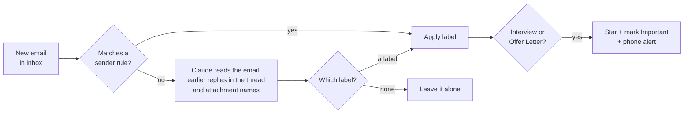

# AutoSort for Gmail

[](https://github.com/yashkumar174/automailreply/actions/workflows/test.yml)
[](LICENSE)

**Never miss the email that matters.** AutoSort runs inside your own Google account,
reads each new email with Claude, and files job-application replies into clear Gmail
labels. When you get an interview or an offer, your phone buzzes.

```
AutoSort
 ├─ Jobs
 │   ├─ Applied        application received / under review
 │   ├─ Interview      interview, test, shortlisted, next round   ⭐ + phone alert
 │   ├─ Offer Letter   an actual offer, joining, onboarding        ⭐ + phone alert
 │   ├─ Rejected       not moving forward
 │   └─ Job Alerts     job listings and recommendations
 └─ Dividends          dividend payment / credit notices for your shares
```

No server, no app to install, nothing to keep running on your laptop. It costs well
under a dollar a month.

---

## Why I built this

I apply to a lot of jobs and internships, mostly through job portals like Naukri,
LinkedIn and Indeed. That means my inbox gets dozens of emails a day: job alerts,
"jobs you may like", recruiter mass mailers, portal newsletters.

The emails that actually matter, the ones saying *"you've been shortlisted"* or *"we'd
like to schedule an interview"*, look almost the same and arrive in the same flood. A
few times I only found one days later, buried under alerts.

Gmail filters didn't solve it:

- **I don't know who will reply.** A reply can come from a company's careers address,
  from Workday or Greenhouse, from a recruiter's personal Gmail, or from the portal
  itself. I can't write a filter for senders I haven't seen yet.
- **Keywords don't work either.** "Interview", "selected" and "offer" appear in job
  alerts and marketing mail all the time, and a rejection and an interview invite both
  start with "Thank you for your application".

What I needed was something that reads an email the way I would and understands what it
*means* for me. So AutoSort hands each email to Claude, which tells apart a real
interview invite from a "50 companies are hiring!" mailer. The important ones get
starred, labeled and pushed to my phone. Everything else stays out of the way.

---

## How it works



- **Runs on Google Apps Script**, inside your Google account. A timer checks your inbox
  every 10 minutes, even when your computer is off.
- **Rules first, Claude second.** Senders that only ever send job alerts are matched by
  address, for free. Everything else goes to Claude (Haiku by default).
- **Claude reads for meaning, not keywords.** Before sending, AutoSort strips quoted old
  replies, tracking links and blank space so the real message fits. Claude also sees up to
  two earlier messages in the thread (so "Sure, Tuesday 3 PM works" is understood as an
  interview) and attachment names (so `Offer_Letter.pdf` counts as an offer). A short
  guide covers tricky cases, like "congratulations, you're shortlisted" being an
  interview rather than an offer.
- **Answers are constrained.** Claude must reply with one of your labels or "None" in a
  fixed JSON format, plus a one-sentence reason that's written to the log, so you can
  see why every email was labeled the way it was.
- **Nothing gets skipped.** Emails are processed oldest first. If Claude is down or rate
  limited, the run stops and the same emails are retried 10 minutes later.

---

## Setup (about 10 minutes)

You need a Gmail account and an [Anthropic API key](https://console.anthropic.com) with a
few dollars of credit.

1. **Create the script.** Go to [script.google.com](https://script.google.com) →
   **New project**, and name it `AutoSort`.
2. **Add the code.**
   - Open [`src/Code.js`](src/Code.js), click **Copy raw file**, and paste it over
     everything in `Code.gs`.
   - Click **+** next to **Files** → **Script**, name it `Config`, and paste
     [`src/Config.js`](src/Config.js) into it.
   - Save with **Ctrl+S**.
3. **Add your API key.** Click the **gear icon (Project Settings)** → **Script properties**
   → **Add script property**:
   - Property: `ANTHROPIC_API_KEY`
   - Value: your key (`sk-ant-...`)

   The key lives in your script's settings, never in the code.
4. **Preview.** Open `Code.gs`, choose **`previewRecentEmails`** in the function dropdown
   and click **Run**. Google asks for permission to read and label your Gmail. You'll see
   an "unverified app" screen because you're running your own script: click
   **Advanced → Go to AutoSort (unsafe) → Allow**. The **Execution log** then shows how
   your recent emails *would* be sorted, without changing anything:

   ```
   AutoSort/Jobs/Interview [claude: invites you to a HackerRank test for the SDE role] Acme <no-reply@greenhouse.io> | Next steps
   AutoSort/Jobs/Job Alerts [rule] Indeed <donotreply@jobalert.indeed.com> | 20 new jobs for you
   (left alone) [claude: a family message about dinner] Mom <mom@example.com> | Dinner Sunday?
   ```

5. **Turn it on.** Choose **`setup`** and click **Run**. New mail is now sorted every
   10 minutes.
6. **(Optional) Sort older mail.** Run **`sortRecentEmails`** to label the last 14 days
   (change `BACKFILL_DAYS` in `Config` for more). Big inboxes are finished over the next
   few timer runs.

Your labels appear in Gmail's left sidebar under **AutoSort** (click **More** if you don't
see them), and in the Gmail app under **☰**. Interview and Offer emails are also in
**Starred**.

| Function | What it does |
|---|---|
| `setup` | Creates the labels and starts the timer. Run again after changing `Config`. |
| `previewRecentEmails` | Shows how recent emails would be sorted. Changes nothing. |
| `sortRecentEmails` | Sorts the last `BACKFILL_DAYS` days. |
| `stop` | Stops the timer. Labels already applied stay. |
| `testNotification` | Sends a test phone alert. |
| `findTelegramChatId` | Telegram setup helper. |
| `cleanUpOldLabels` | Removes labels left over from older versions of AutoSort. |

---

## Phone alerts

Gmail's own notifications fire the moment an email arrives, before AutoSort has read
it, so they can't tell an interview invite from a job alert. AutoSort sends its own
alert right after it labels an email **Interview** or **Offer Letter**:

> 🎉 **Interview: Acme Talent**
> Next steps for Software Engineer at Acme
> [Open in Gmail]

### Telegram (recommended)

1. **Create a bot.** In Telegram, search for **@BotFather** (blue checkmark), tap
   **Start**, send `/newbot`, and choose a name and a username ending in `bot`.
   BotFather replies with a **token** like `7123456789:AAH...`. Keep it secret.
2. **Save the token** as the script property `TELEGRAM_BOT_TOKEN`.
3. **Message your bot first.** Search for your bot's username in Telegram (or tap the
   `t.me/...` link from BotFather), tap **Start**, and send `hi`. A bot can't message you
   until you've messaged it.
4. **Get your chat ID.** Run `findTelegramChatId`. The log shows
   `Your chat ID is 123456789`. Save it as the script property `TELEGRAM_CHAT_ID`.
5. **Test it.** Run `testNotification`.

### ntfy

[ntfy](https://ntfy.sh) needs no account: install the app, subscribe to a long random
topic name, save it as the script property `NTFY_TOPIC`, and run `testNotification`.
Anyone who knows the topic name can read your alerts, so make it hard to guess.

ntfy.sh sometimes refuses connections from Google's servers (`Address unavailable`). If
that happens, use Telegram and delete the `NTFY_TOPIC` property.

Alerts arrive within 10 minutes of the email (set `RUN_EVERY_MINUTES: 5` in `Config` for
faster ones). Emails older than a day, e.g. from `sortRecentEmails`, are labeled but don't
trigger alerts.

---

## Customizing

Everything lives in [`src/Config.js`](src/Config.js). After editing, save and run `setup`
again.

- **A tricky email keeps being mislabeled?** Add a line to `AI_GUIDE` describing the case,
  e.g. `- Campus drive announcements sent to the whole college are Jobs/Job Alerts.`
- **Another alert-only sender?** Add its address to the `Jobs/Job Alerts` rule in `RULES`.
  Those emails skip Claude and move out of the inbox. Only add senders that never send
  real application updates.
- **A person you never want to miss?** Add a rule:

  ```js
  { label: 'VIP', from: ['priya.recruiter@gmail.com', '@dream-company.com'], star: true, notify: true },
  ```

- **A new kind of email?** Add an entry to `AI_CATEGORIES` with a specific description:

  ```js
  { label: 'Bills', description: 'Bills, invoices, payment due reminders, or receipts.' },
  ```

- **Sharper judgement?** Set `AI_EFFORT: 'high'`, or switch `CLAUDE_MODEL` to
  `'claude-opus-5-5'`.

Each category or rule can set `star`, `important`, `notify` and `archive` to `true`.

---

## Cost

Rules are free. Other emails are sent to Claude: up to 6,000 characters of the cleaned-up
email plus a short excerpt of up to two earlier messages in the thread.

| Model (`CLAUDE_MODEL`) | Per email (approx.) | 20 emails/day to Claude |
|---|---|---|
| `claude-haiku-5-5` (default) | ~$0.0005–0.001 | ~$0.30–0.60 / month |
| `claude-opus-5-5` (most accurate) | ~$0.01–0.02 | ~$6–12 / month |

Google Apps Script is free. Set `AI_ENABLED: false` to run sender rules only, at no cost.

---

## Privacy and security

- **The script runs in your own Google account.** There's no AutoSort server. You can
  read every line of code before you authorize it, and you should.
- **What leaves your account:** for emails no rule matches, the sender, date, subject,
  attachment names and cleaned-up text (plus short excerpts of up to two earlier messages
  in the thread) are sent to the Anthropic API to be
  classified. For phone alerts, the sender's name and the subject go to Telegram or ntfy.
- **Secrets stay out of the code.** Your API key, bot token and ntfy topic live in Script
  Properties, which only you can see. Never paste them into `Code.gs` or `Config.gs`, and
  never commit them to a repository.
- **Emails are never deleted or sent.** AutoSort only adds and removes its own labels,
  stars, marks as Important, and (for known alert senders) archives.
- **Prompt injection is contained.** Email content is treated as untrusted data, and
  Claude can only answer with one of your label names, so an email can't make AutoSort do
  anything else.

To remove AutoSort completely: run `stop`, delete the project at
[script.google.com](https://script.google.com), and remove its access at
[myaccount.google.com/permissions](https://myaccount.google.com/permissions).

---

## Troubleshooting

| Symptom | Fix |
|---|---|
| Function dropdown says **No functions** | You have `Config.gs` open. Click `Code.gs`, and save it. |
| Log says `no rule, no API key` | The script property must be named exactly `ANTHROPIC_API_KEY`. |
| `Claude API returned 401` | The API key is wrong or was deleted. |
| `Claude API returned 400` mentioning credit | Add credit in the Anthropic console. |
| `Claude API returned 429` or `529` | Rate limit or overload. The run stops and retries in 10 minutes; nothing is skipped. |
| `Address unavailable: https://ntfy.sh` | ntfy is refusing Google's servers. Use Telegram. |
| An email got the wrong label | Check its reason in **Executions**, then add a line to `AI_GUIDE`. |
| No "Advanced" link on the unverified-app screen | Work and school accounts may block personal scripts. Use a personal Gmail account. |

### Updating from an earlier version

Paste the latest `Code.js` and `Config.js`, run **`cleanUpOldLabels`** once (it moves
emails from old labels such as `Jobs/Offer` and `Job Alerts` to their new names and removes
unused ones; no email is deleted), then run `setup`.

---

## Limitations

- **Not instant.** Emails are sorted up to 10 minutes after they arrive (1 minute is the
  Apps Script minimum, but uses more of the daily quota).
- **Daily quotas.** Free Google accounts get about 90 minutes of timer run time per day,
  plenty for a 10-minute schedule, but tight at 1 minute.
- **Inbox only.** Mail that your own Gmail filters skip past the inbox isn't sorted.
- **Claude can be wrong.** It's told to prefer *Interview* when unsure, so you get the
  occasional false alarm rather than a missed opportunity. Check the logged reasons and
  refine `AI_GUIDE` if something keeps slipping.

---

## Project structure

```
src/
  Code.js          sorting, Claude call, phone alerts, label management
  Config.js        labels, rules, AI guide and settings (the file you edit)
  appsscript.json  Apps Script manifest
test/
  run-tests.js     offline tests with Gmail and the Claude API faked
```

## Development

Run the tests (Node 18+, no dependencies, no Google account or API key needed):

```sh
npm test
```

`src/` is laid out for [clasp](https://github.com/google/clasp), so you can push from
this repo instead of copy-pasting:

```sh
npm install -g @google/clasp
clasp login
clasp create --type standalone --title AutoSort --rootDir src
clasp push
```

Issues and pull requests are welcome.

## License

[MIT](LICENSE)
